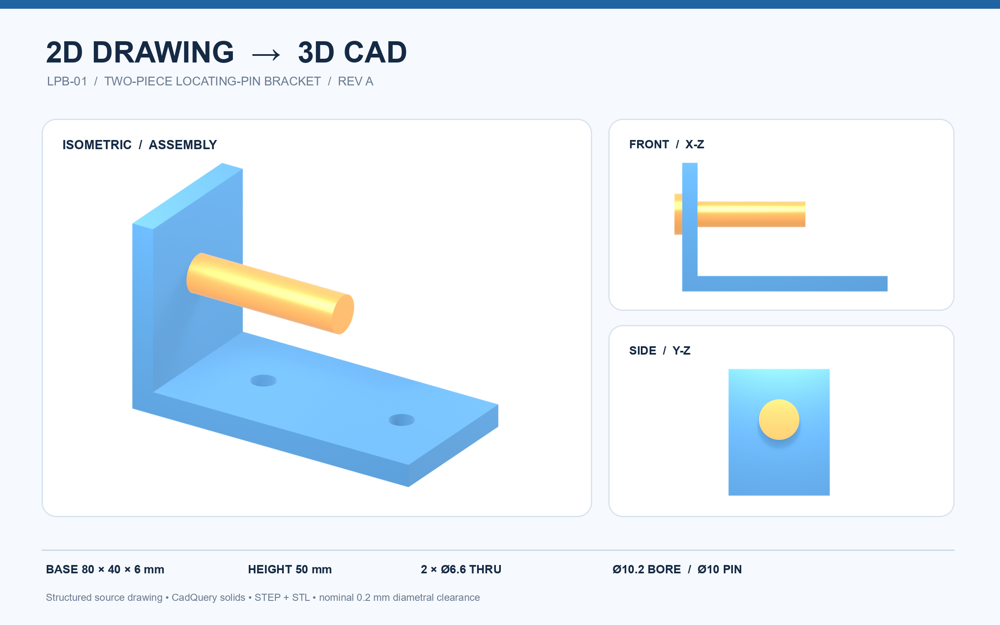

# Drawing to 3D CAD | 工程图转三维 CAD

**A dimension-led 2D drawing to 3D CAD service sample.** This project shows how a clearly dimensioned mechanical drawing can be rebuilt as editable CAD solids, exported to STEP/STL, and reviewed against recorded dimensions.

**工程图转三维 CAD 服务样品：**展示如何根据尺寸明确的机械图纸重建 CAD 实体、导出 STEP/STL，并用尺寸记录进行复核。



## See the work

- [Open the bilingual service site](https://drawing-to-cad-studio.zexuanzjb.chatgpt.site/) *(currently private preview; access may be limited)*
- [Watch the 20-second conversion demo](site-public/assets/demo.mp4)
- [Read the dimension comparison report](site-public/assets/comparison-report.pdf)
- [Download the complete sample package](site-public/assets/sample-package.zip)
- [View the original structured drawing (PDF)](site-public/assets/source-drawing.pdf)
- [Inspect the STEP assembly](site-public/assets/assembly.step)

## Sample scope

The LPB-01 demonstrator is a two-piece locating-pin bracket: one mounting bracket and one pin. Its drawing specifies the overall envelope, plate thicknesses, mounting-hole locations, bore, pin, and pin head. The project includes a CadQuery model, STEP and STL exports, front/side/isometric views, a 20-second video, and a check report.

The sample records nominal geometry checks. It does not claim manufacturing approval: material, finish, fit class, and production tolerances need project-specific engineering confirmation.

## How the service handles a drawing

1. Check that the PDF/DXF is readable and dimensioned well enough for the agreed scope.
2. List missing, conflicting, or uncertain dimensions and ask the client to confirm them before modeling affected features.
3. Build the CAD solids and compare key dimensions and exports with the confirmed drawing.
4. Deliver the agreed STEP/STL files, views, and a concise check record.

Blurry photographs and incomplete drawings are not treated as exact inputs. Human review is required when geometry, dimensions, or tolerances are unclear.

## Run the website locally

```bash
npm install
npm run dev
```

Build the static site with `npm run build`. The bilingual site source is in `site-src/`; original demonstrator assets are in `site-public/assets/`.

## Free beta

The initial beta is free: each participant may submit one simple part with clearly dimensioned PDF/DXF input. A person reviews dimensions and confirms the scope before modeling; this is not an automatic converter for arbitrary photos or incomplete drawings. Paid plans may be introduced after usage and demand are established, with notice before any charges.

To request a beta slot, email **zexuanzjb@gmail.com** with the drawing format, part count, intended use, required outputs, known open dimensions/tolerances, and target deadline. Attach drawings in the email; the website does not receive or store them.

## Credits and license

The website architecture is adapted from [ScrewFast](https://github.com/mearashadowfax/ScrewFast), distributed under the MIT License; the upstream `LICENSE` is included. LPB-01 sample drawing/model/render assets are original portfolio demonstrator material.
